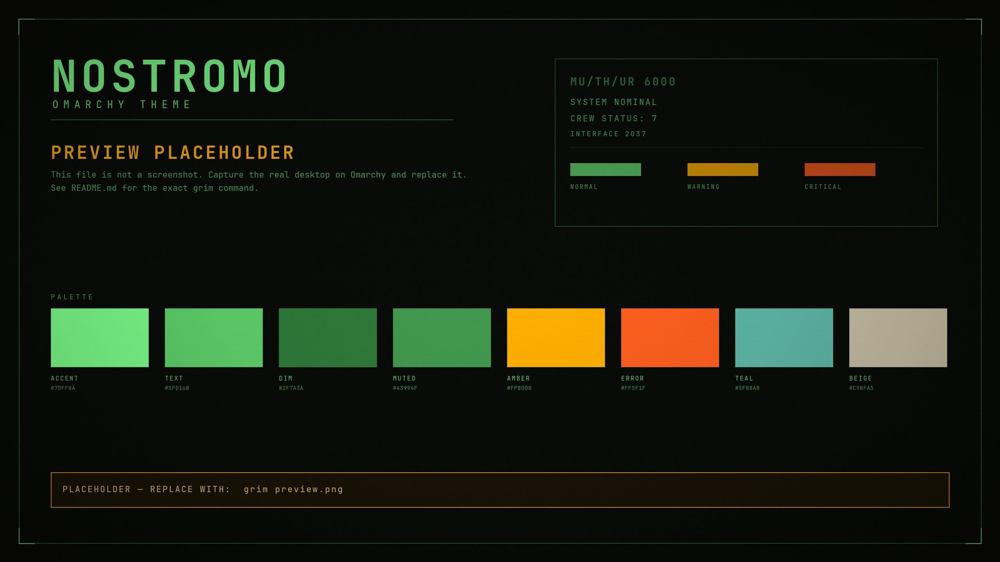

# NOSTROMO

An Omarchy theme for the used future: near-black hull plating, phosphor-green
terminals, amber caution labels, and orange-red for things that have gone wrong.
Square corners, opaque panels, thin borders, no blur, no shadows, all-caps
labels, monospace everywhere.

Built for **Omarchy 4.x**. The root-level `hyprland.conf`, `hyprlock.conf`,
`waybar.css`, `walker.css`, `mako.ini`, `swayosd.css`, and `cava_theme` are
best-effort legacy files for Omarchy 2.x/3.x and are ignored by Omarchy 4.



> The preview above is a generated placeholder, not a screenshot. See
> [Replacing the preview](#replacing-the-preview) to capture the real desktop.

## Install

### Omarchy 4 (recommended)

```bash
omarchy theme install https://github.com/LiamTheCreat0r/Omarchy-Nostromo
```

The installer clones the repo, derives the theme name from its slug, and applies
it. This repo's slug (`Omarchy-Nostromo`) installs as `nostromo`; the
recommended convention is `omarchy-[themename]-theme`. A slug that produces a
different name installs under that name instead. You can also use
**Install → Style → Theme** in the Omarchy menu.

To apply it again later:

```bash
omarchy theme set nostromo
```

To update an installed copy:

```bash
omarchy theme update
```

To remove it:

```bash
omarchy theme remove nostromo
```

### Manual / local install

```bash
git clone https://github.com/LiamTheCreat0r/Omarchy-Nostromo \
  ~/.config/omarchy/themes/nostromo
omarchy theme set nostromo
```

Omarchy 4 deliberately drops `*.lua`, terminal configs, and `vscode.json` from
any theme installed from a git repo. That is expected: `colors.toml` regenerates
Hyprland, Neovim, terminal, VS Code, and shell colors on your machine. The
`hyprland.lua` and `neovim.lua` in this repo are for local reference and manual
setups; the generated versions are what Omarchy 4 uses.

### Omarchy 2.x / 3.x

Copy the legacy files into the locations your Omarchy release reads, or use the
theme directory directly if your version supports it. They are not consumed by
Omarchy 4:

```text
hyprland.conf     Hyprland border / gap / decoration overrides
hyprlock.conf     hyprlock color variables (layout stays Omarchy's)
waybar.css        Waybar palette and state colors
walker.css        Walker palette and selection
mako.ini          Mako palette and urgency rules
swayosd.css       SwayOSD palette
cava_theme        cava gradient
```

## Requirements

- Omarchy 4.0 or newer (developed against the 4.x theme layout; 4.0.6 was the
  stable reference).
- A monospace font. The theme is designed around **JetBrains Mono**; Omarchy
  normally provides `JetBrainsMono Nerd Font`.
- **Yaru-sage** icons for the file manager (part of the standard Yaru set).

Install the font and set it as the system monospace face:

```bash
sudo pacman -S ttf-jetbrains-mono-nerd
omarchy font set "JetBrainsMono Nerd Font"
```

`Share Tech Mono` (AUR: `ttf-share-tech-mono`) is an optional display face for
wallpapers or labels. It has no Nerd Font glyphs, so do not use it as the
terminal font unless you do not need icons.

## Palette

The palette is deliberately narrow. Green is the interface; amber is a warning;
orange-red is a failure. Teal and beige are supporting ANSI colors, not accents.

### ANSI

| Key | Hex | Role |
| --- | --- | --- |
| `color0` | `#0a0c09` | terminal background (resolved from `background`) |
| `color1` | `#ff5f1f` | critical / error |
| `color2` | `#7dff8a` | phosphor green |
| `color3` | `#ffb000` | amber warning |
| `color4` | `#4a8f89` | Isolation teal |
| `color5` | `#b58a5a` | rusty tan |
| `color6` | `#5fb8a8` | cyan |
| `color7` | `#5fd16b` | primary text (resolved from `foreground`) |
| `color8` | `#2f7a3a` | dim green / inactive border |
| `color9` | `#ff8a50` | bright red-orange |
| `color10` | `#a6ffae` | bright green |
| `color11` | `#ffd060` | bright amber |
| `color12` | `#5fa8a0` | bright teal |
| `color13` | `#d9b88a` | bright tan |
| `color14` | `#8fd8cc` | bright cyan |
| `color15` | `#e6dcc3` | warm beige |

### Semantic

| Key | Hex | Role |
| --- | --- | --- |
| `background` | `#0a0c09` | base surface |
| `foreground` | `#5fd16b` | body text |
| `accent` | `#7dff8a` | focus, selection, active border |
| `bright_foreground` | `#7dff8a` | cursor |
| `muted` | `#43994f` | secondary text |
| `dark_foreground` | `#2f7a3a` | disabled / decorative |
| `light_foreground` | `#c9bfa5` | beige plastic |
| `selection` | `#1b2a1d` | quiet green-tinted surface |
| `selection_background` | `#7dff8a` | selected text background |
| `selection_foreground` | `#0a0c09` | selected text |
| `lighter_background` | `#141812` | raised surface / titlebars |
| `dark_background` | `#070908` | recessed surface |
| `darker_background` | `#040504` | deepest recess |

### Contrast

WCAG AA normal text needs 4.5:1. Measured against `background` `#0a0c09`:

| Pair | Ratio | Verdict |
| --- | --- | --- |
| `foreground` on `background` | 10.12:1 | AAA |
| `accent` on `background` | 15.47:1 | AAA |
| `muted` on `background` | 5.52:1 | AA |
| `amber` on `background` | 10.72:1 | AAA |
| `critical` on `background` | 6.46:1 | AA |
| `color4` teal on `background` | 5.22:1 | AA |
| `color15` beige on `background` | 14.39:1 | AAA |
| `foreground` on `lighter_background` | 9.25:1 | AAA |
| `muted` on `lighter_background` | 5.05:1 | AA |
| `dim` (`color8`) on `background` | 3.71:1 | borders/non-text only |

`color8` / `dark_foreground` is intentionally below AA. It is used for borders,
rules, inactive chrome, and decorative labels — never for body copy.

## Files

| File | Purpose |
| --- | --- |
| `colors.toml` | Omarchy 4 palette. Drives generated Hyprland, Neovim, terminal, VS Code, and shell colors; `btop.theme` is shipped directly. |
| `shell.toml` | Omarchy 4 shell surfaces: bar, popups, notifications, launcher, menu, polkit, lock, image picker. |
| `backgrounds/` | Three original 3840×2160 wallpapers. |
| `preview.png` | Theme picker preview. Placeholder until you capture a real screenshot. |
| `unlock.png` | 800×188 transparent Plymouth/SDDM logo, already in phosphor green. |
| `preview-unlock.png` | 1920×1080 lock-screen preview generated with Omarchy's own layout. |
| `icons.theme` | `Yaru-sage` icon set for the file manager. |
| `btop.theme` | btop green → amber → orange-red gradients, opaque background. |
| `hyprland.lua` | Omarchy 4 / manual Hyprland overrides: square, opaque, thin borders, no blur or shadows. |
| `neovim.lua` | aether.nvim palette for manual installs. |
| `hyprland.conf` | Legacy Omarchy 2/3 Hyprland overrides. |
| `hyprlock.conf` | Legacy hyprlock color variables. |
| `waybar.css` | Legacy Waybar palette and states. |
| `walker.css` | Legacy Walker palette and selection. |
| `mako.ini` | Legacy Mako palette and urgency rules. |
| `swayosd.css` | Legacy SwayOSD palette. |
| `cava_theme` | Legacy/standalone cava gradient. |
| `extras/crt.frag` | Optional CRT shader: scanlines, barrel curve, vignette. |
| `extras/toggle-crt.sh` | Toggle the shader through `hyprctl`. |
| `extras/README.md` | Shader enable/disable and keybind instructions. |

### Not shipped

- **`gtk.css`** — Omarchy 4 does not read a per-theme GTK stylesheet. GTK apps
  use `Adwaita-dark` plus the generated palette; a theme-local `gtk.css` would
  be dead weight.
- **`steam.css` / `vencord.theme.css`** — no Omarchy 4 hook exists for these
  apps. Shipping a file that nothing loads would be misleading. Use each app's
  own theme mechanism if you want it; Solitude's “Bypass Theme-Hook” approach is
  one option.
- **`vscode.json`** — Omarchy generates the VS Code theme from `colors.toml`,
  and the installer drops `vscode.json` from repo themes.
- **`light.mode`** — `mode = "dark"` in `colors.toml` is the supported marker.

## Wallpapers

Three 4K originals, no film stills or logos:

- `01-muthur-radar.jpg` — MU/TH/UR radar sweep and a quiet readout.
- `02-sevastopol-corridor.jpg` — one-point corridor, amber emergency strips.
- `03-crew-manifest.jpg` — crew manifest and a faint `07`.

Cycle them with `Super + Ctrl + W`, or:

```bash
omarchy theme bg next
omarchy theme bg current
```

Omarchy stores your choice per theme and restores it when you switch back.

## Replacing the preview

`preview.png` is a labeled placeholder. On the running desktop:

```bash
grim preview.png
```

To capture a specific output, or to resize for a smaller repo:

```bash
grim -o DP-1 preview.png
grim - | magick - -resize 2560x1440 preview.png
```

Then commit the replacement:

```bash
git add preview.png && git commit -m "Add real preview screenshot"
```

## Unlock / boot screen

The theme ships `unlock.png` (800×188, transparent, already phosphor green) and
`preview-unlock.png`. Apply the logo to Plymouth/SDDM:

```bash
omarchy plymouth set-by-theme nostromo
```

Regenerate the preview with Omarchy's own layout:

```bash
omarchy plymouth preview '#0a0c09' '#5fd16b' \
  ~/.local/state/omarchy/current/theme/unlock.png preview-unlock.png
```

The preview uses Omarchy's stock Plymouth entry/lock/bullet chrome; only the
wordmark is ours. Omarchy 4's QML lock screen is square and fully themed by
`shell.toml`.

## Optional CRT shader

The shader is not enabled by default. It adds subtle scanlines, a gentle barrel
curve, and a vignette without shifting the palette.

```bash
hyprctl keyword decoration:screen_shader \
  ~/.local/state/omarchy/current/theme/extras/crt.frag
```

Disable it:

```bash
hyprctl keyword decoration:screen_shader ""
```

To toggle it from a keybind, add this to `~/.config/hypr/looknfeel.lua`:

```lua
o.bind("SUPER + SHIFT + F12", "Toggle CRT shader",
       "~/.local/state/omarchy/current/theme/extras/toggle-crt.sh")
```

See [`extras/README.md`](extras/README.md) for the permanent configuration and
caveats (curvature distorts screenshots and costs a little GPU).

## Verification

Run these on an Omarchy 4 machine after installing:

```bash
omarchy theme list | grep -i nostromo
omarchy theme set nostromo
omarchy theme current
hyprctl getoption general:col.active_border
hyprctl getoption decoration:rounding
hyprctl getoption decoration:blur.enabled
hyprctl getoption decoration:shadow.enabled
omarchy theme bg next
omarchy theme bg current
```

Notification urgency:

```bash
notify-send -u low "NOSTROMO" "Low urgency"
notify-send -u normal "NOSTROMO" "Normal urgency"
notify-send -u critical "NOSTROMO" "Critical urgency"
```

Expected: low is dim green, normal uses the phosphor countdown accent, critical
uses the orange-red `urgent` color and does not auto-dismiss.

This repository was assembled and statically checked off-device. The runtime
checks above still need to be run on Omarchy; see the project handoff notes for
what was and was not verified.

## Design notes

- **Square everything.** `rounding = 0`, no rounded cards, no rounded controls.
- **Opaque.** No window transparency, no blur, no glass. The only dim layers
  are the launcher, menu, and polkit scrims behind their cards.
- **Thin phosphor borders.** 1–2px, active border full `#7dff8a`, inactive
  `#2f7a3a`.
- **Monospace and caps.** Labels are uppercase, spaced, and small. Body text is
  sentence case for readability.
- **Amber is a warning, not a second accent.** Red-orange is reserved for
  critical notifications and errors.

## Credits

- Structure and Omarchy conventions follow
  [HANCORE-linux/omarchy-solitude-theme](https://github.com/HANCORE-linux/omarchy-solitude-theme)
  and the official Omarchy theme documentation.
- All wallpapers, the wordmark, and the preview are original work generated for
  this theme.
- Neovim colors use [aether.nvim](https://github.com/omacom/aether.nvim), the
  engine Omarchy ships.

## License

MIT. See [LICENSE](LICENSE).
